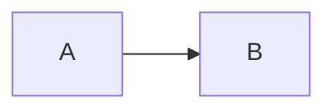

# Fences



~~~mermaid
pie
  "a": 1
~~~

````mermaid
sequenceDiagram
  A->>B: a ``` in a message
````

```mermaid title="With attributes"
info
```

```Mermaid
info
```

```js
console.log('not a diagram')
```

```pele
flowchart LR
  A --> B
```

```
flowchart LR
```
